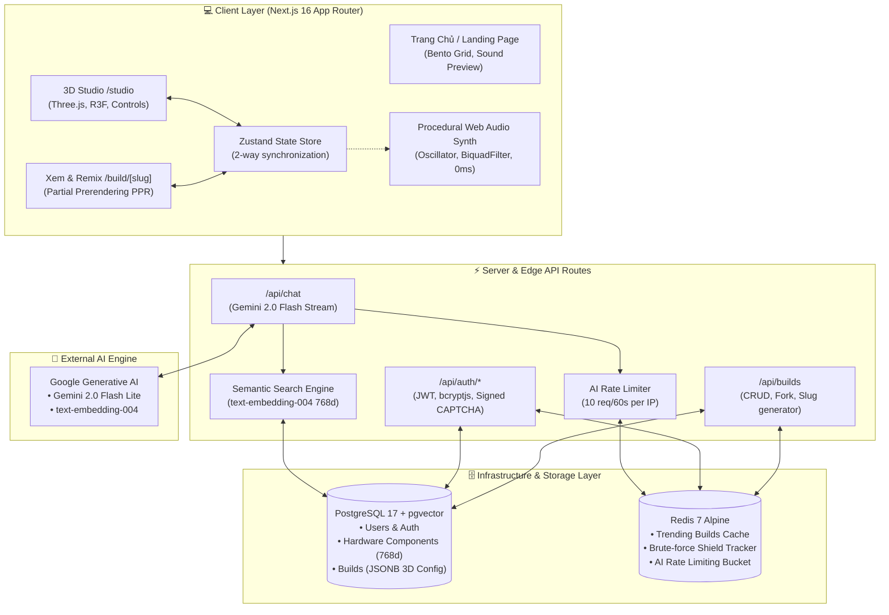

# ⌨️ KeyCraft 3D — Interactive Custom Mechanical Keyboard Studio & AI Acoustic Architect

> **Cinematic Dark Luxury 3D Studio, Procedural Web Audio Synthesizer, AI Agentic Hardware Architect & pgvector Semantic Search RAG.**

[](https://nextjs.org/)
[](https://react.dev/)
[](https://threejs.org/)
[](https://github.com/pgvector/pgvector)
[](https://redis.io/)
[](https://ai.google.dev/)
[](https://www.docker.com/)
[](https://vitest.dev/)

---

## 🌟 Tổng Quan Dự Án (Project Overview)

**KeyCraft 3D** là ứng dụng web thương mại mô phỏng và tùy biến bàn phím cơ 3D thế hệ mới, kết hợp trải nghiệm đồ họa chân thực, âm học thời gian thực và trí tuệ nhân tạo chuyên sâu:

1. **Không gian 3D Cinematic Dark Luxury:** Dựng bằng React Three Fiber và Procedural Geometry với 7 tầng linh kiện bóc tách vật lý (Bottom Case, PCB mạ vàng, Poron Foam tiêu âm, Switch Plate, Switches, Keycaps Cherry profile và Top Case viền kim loại vát cạnh).
2. **Bộ tổng hợp âm thanh phím cơ thời gian thực (Zero-latency Web Audio API):** Mô phỏng va đập âm học vật lý không cần tải file mẫu ngoài: biến đổi cao độ và âm sắc theo chất liệu plate (*Nhôm Crisp Clack vs POM Deep Thock*) và loại switch (*Linear, Tactile, Clicky, Silent*).
3. **Kiến trúc sư âm học AI & pgvector RAG:** Tích hợp Google Gemini 2.0 Flash với kỹ thuật **Agentic Tool Calling** (điều khiển trực tiếp Canvas 3D) và **Semantic Search 768 chiều** qua `pgvector` tra cứu cơ sở dữ liệu linh kiện thực tế (*Gateron Oil King, Boba U4T, Cherry MX Black...*).
4. **Bảo mật Enterprise & Brute-force Shield:** Xác thực JWT trong `httpOnly, secure` cookies, mã hóa mật khẩu `bcryptjs` chuẩn production, theo dõi đăng nhập sai qua Redis và kích hoạt thử thách Signed HMAC CAPTCHA chống tấn công tự động.
5. **Thư viện cộng đồng & Redis Caching:** Lưu trữ cấu hình 3D toàn vẹn dạng `JSONB` trong PostgreSQL, sinh link chia sẻ chuẩn SEO (`/build/[slug]`), cache danh sách Trending Builds qua Redis (TTL 60s) và chống spam bằng AI Rate Limiting.

---

## 🏛️ Sơ Đồ Kiến Trúc Hệ Thống (System Architecture)



---

## 🚀 Hướng Dẫn Chạy Dự Án (Quick Start)

### Cách 1: Khởi Chạy 1 Lệnh Với Docker Compose (Khuyên Dùng)

Yêu cầu máy tính đã cài đặt [Docker Desktop](https://www.docker.com/products/docker-desktop/).

```bash
# 1. Clone mã nguồn
git clone https://github.com/your-username/keycraft-3d.git
cd keycraft-3d

# 2. Tạo file cấu hình biến môi trường
cp .env.example .env.local

# 3. Khởi chạy trọn gói cả 3 container (Web App, PostgreSQL pgvector, Redis)
docker compose up -d --build
```

Mở trình duyệt tại [http://localhost:3000](http://localhost:3000) để trải nghiệm ứng dụng!

---

### Cách 2: Chạy Môi Trường Phát Triển Cục Bộ (Local Development)

Yêu cầu: **Node.js 20+** hoặc **Node.js 22**.

```bash
# 1. Cài đặt toàn bộ thư viện dependencies
npm install

# 2. Chuẩn bị file môi trường
cp .env.example .env.local
# (Điền GOOGLE_GENERATIVE_AI_API_KEY nếu muốn dùng AI chat trực tiếp)

# 3. Chạy các container bổ trợ Database & Cache (nếu có Docker)
docker compose up -d postgres redis

# 4. Nạp dữ liệu hạt giống linh kiện phần cứng vào PostgreSQL
npx tsx scripts/seedComponents.ts

# 5. Khởi động máy chủ Next.js
npm run dev
```

---

## 🧪 Kiểm Thử Tự Động & Tiêu Chuẩn Chất Lượng (Quality Assurance)

Dự án tuân thủ nghiêm ngặt **100% TypeScript Strict Mode** và quy trình kiểm thử tự động toàn diện:

```bash
# 1. Kiểm tra tĩnh kiểu dữ liệu (TypeScript Strict, cấm dùng `any`)
npx tsc --noEmit

# 2. Kiểm tra quy tắc định dạng và Clean Code (ESLint 9)
npm run lint

# 3. Chạy toàn bộ 236 Unit & Integration Tests với Vitest
npm test -- --run

# 4. Kiểm tra biên dịch bản build đóng gói Production
npm run build
```

**Kết quả kiểm thử:**
- **40 Test Suites** / **236 Tests PASS 100%** (Store, 3D Geometry, Web Audio Math, Auth/Security, Brute-force, pgvector RAG, Redis Cache, API Routes).

---

## 📦 Danh Mục Công Nghệ Sử Dụng (Tech Stack)

| Hạng mục | Công nghệ | Chi tiết sử dụng |
| :--- | :--- | :--- |
| **Frontend Framework** | **Next.js 16 (App Router)** | Server Components, Turbopack, Partial Prerendering (PPR), Route Splitting (`/`, `/studio`, `/build/[slug]`). |
| **3D Rendering** | **React Three Fiber / Three.js** | Procedural 7-layer geometry, N8AO Ambient Occlusion, Contact Shadows, Bloom Postprocessing, 360 Turntable. |
| **Styling & Motion** | **Tailwind CSS v4 + Framer Motion** | Cinematic Dark Luxury, Frosted Liquid Glass (`backdrop-blur-xl`), Spring physics, Bento Grid. |
| **State Management** | **Zustand** | Đồng bộ 2 chiều thời gian thực giữa 3D Viewport, UI Controls, Auth state và AI Tool Calling. |
| **Audio Engine** | **Web Audio API** | Procedural synthesizer zero-latency ($\le 5\text{ms}$), mô phỏng tần số vật lý của Plate và Switch. |
| **AI & RAG** | **Vercel AI SDK + Google Gemini** | Gemini 2.0 Flash Lite, Agentic UI Tool Calling, `text-embedding-004` (768 dimensions), In-memory Fallback. |
| **Database** | **PostgreSQL 17 + pgvector** | Schema quan hệ qua **Drizzle ORM**, cột vector 768 chiều với toán tử Cosine `<=>`, lưu cấu hình JSONB. |
| **Cache & Security** | **Redis 7 + jose + bcryptjs** | Cache-Aside cho Trending Builds, Fixed-Window AI Rate Limiting, Brute-force Shield, Signed HMAC CAPTCHA. |
| **Containerization** | **Docker & Docker Compose** | Multi-stage Dockerfile tối ưu kích thước image (<160MB), Non-root user security. |

---

## 💎 Điểm Nhấn Kỹ Thuật Đáng Chú Ý Cho CV / Portfolio (Engineering Highlights)

1. **Hiệu Năng Đồ Họa 3D 60fps Trên Web:**
   - Sử dụng Procedural Geometry kết hợp biến dạng đỉnh (Vertex displacement) cho keycap profile Cherry mà không cần nạp các tệp OBJ/FBX hàng chục MB.
   - Cơ chế tách lớp (Exploded View) thực thi trực tiếp qua Imperative Matrix Mutation trong `useFrame` với `MathUtils.lerp`, không gây re-render vòng lặp React.
2. **Web Audio Physical Synthesis Độc Quyền:**
   - Giả lập tiếng gõ phím cơ hoàn toàn bằng thuật toán toán học (`OscillatorNode` + `BiquadFilterNode` bandpass resonance) với độ trễ 0ms, không tiêu tốn băng thông tải âm thanh mẫu.
3. **Agentic AI & pgvector RAG Khép Kín:**
   - Mô hình AI không chỉ trả lời văn bản mà còn thực thi Tool Calling trực tiếp để biến đổi cấu hình 3D, bóc tách linh kiện và tra cứu cơ sở dữ liệu vector 768 chiều.
   - Kiến trúc Graceful Degradation: Tự động fallback sang In-memory Vector Search và Memory Rate Limiter nếu cơ sở dữ liệu gặp sự cố.
4. **Bảo Mật Cấp Doanh Nghiệp (Enterprise Security):**
   - JWT Access/Refresh tokens lưu trong `httpOnly, sameSite=lax` cookies chống hoàn toàn XSS.
   - Brute-force Shield thông minh: Theo dõi số lần nhập sai qua Redis, tự động kích hoạt câu đố Signed HMAC CAPTCHA khi sai $\ge 3$ lần và tạm khóa tài khoản khi cố tình tấn công dò mật khẩu.
5. **Tối Ưu Hóa Container Production:**
   - Multi-stage Dockerfile phân tách các bước `deps`, `builder` và `runner`. Tận dụng chế độ `output: "standalone"` của Next.js 16 giúp giảm kích thước từ 1.5GB xuống 160MB.

---

## 📄 Bản Quyền & Giấy Phép (License)

Dự án được phát triển nhằm mục đích nghiên cứu công nghệ, đào tạo kỹ thuật chuyên sâu và xây dựng đồ án mẫu chuẩn Production.  
Mã nguồn phát hành theo giấy phép [MIT License](LICENSE).
