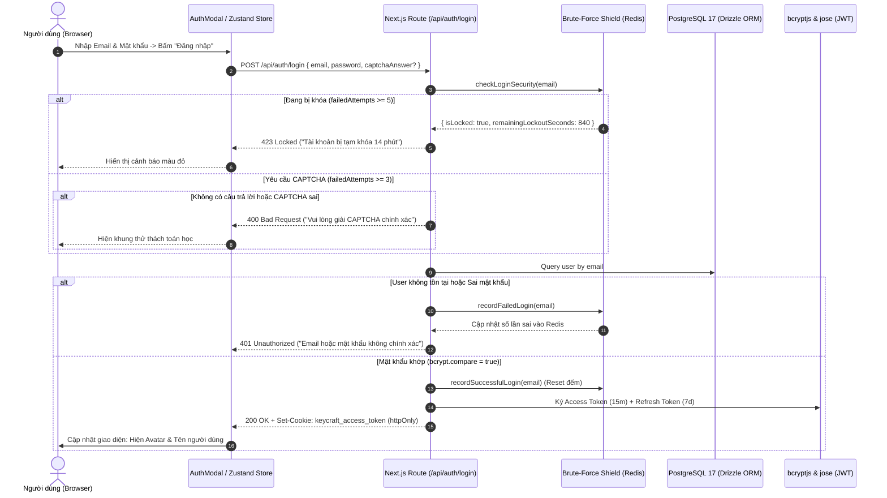

# Bách Khoa Toàn Thư Kiến Trúc Bảo Mật: JWT Authentication, Brute-Force Shield & Signed Cryptographic CAPTCHA

> **Mã tài liệu:** `11-auth-jwt-brute-force-captcha`  
> **Dự án:** KeyCraft 3D — Custom Mechanical Keyboard Studio  
> **Thuộc chặng:** Chặng 3: Dữ Liệu Lớn, Vector Search & Kiến Trúc Sản Phẩm Thực Tế (Task 3.1b)  
> **Trình độ:** Từ số 0 đến Kiến trúc sư Bảo mật Fullstack (Junior -> Senior Architect)

---

## 1. Bách Khoa Công Nghệ Sử Dụng Trong Task

### 1.1. `bcryptjs` — Chuẩn mã hóa mật khẩu một chiều thích ứng (Adaptive One-Way Hashing)
- **Định nghĩa:** `bcryptjs` là thư viện JavaScript thuần (pure JavaScript) triển khai thuật toán băm mật khẩu `bcrypt` dựa trên mật mã khối Blowfish do Niels Provos và David Mazières thiết kế năm 1999.
- **Tác dụng trong KeyCraft 3D:** Mã hóa mật khẩu người dùng trước khi lưu trữ vào bảng `users` trong PostgreSQL. Ngay cả khi cơ sở dữ liệu bị lộ lọt (database breach), kẻ tấn công cũng không thể dịch ngược (reverse-engineer) chuỗi băm trở lại mật khẩu gốc.
- **Cách sử dụng (Syntax chuẩn):**
  ```typescript
  import bcrypt from 'bcryptjs';

  // 1. Tạo chuỗi Salt ngẫu nhiên với 12 cost factor rounds (2^12 lần lặp)
  const salt = await bcrypt.genSalt(12);

  // 2. Băm mật khẩu gốc kèm Salt
  const passwordHash = await bcrypt.hash('mySecretPassword@2026', salt);

  // 3. So khớp mật khẩu khi đăng nhập (Timing-safe comparison)
  const isMatch = await bcrypt.compare(inputPassword, storedHash);
  ```
- **Điểm mạnh (Pros):**
  - **Tự động gắn Salt (Salted by default):** Miễn nhiễm hoàn toàn với các cuộc tấn công dùng bảng tra cứu sẵn (Rainbow Table Attack).
  - **Khả năng co giãn chi phí tính toán (Work Factor / Cost Factor):** Khi năng lực phần cứng máy tính và chip GPU/ASIC mạnh lên theo thời gian, ta có thể tăng hệ số vòng lặp từ 10 lên 12, 14 mà không cần đổi thuật toán.
  - **Không phụ thuộc C++ Binding:** Chạy mượt mà trên mọi môi trường Node.js, Alpine Linux container và Edge Runtime mà không sợ lỗi `node-gyp rebuild`.
- **Hạn chế (Cons):**
  - Chạy bằng JavaScript nên tiêu tốn CPU chính của Node.js hơn so với bản native C++ nếu server phải chịu hàng chục nghìn lượt đăng ký đồng thời (trong KeyCraft, chi phí 12 rounds ~ 150ms/hash là mức cân bằng vàng giữa bảo mật và hiệu năng).

---

### 1.2. `jose` — Thư viện chuẩn mực xử lý JSON Web Tokens (JWT) & Web Cryptography
- **Định nghĩa:** `jose` (viết tắt của Javascript Object Signing and Encryption) là bộ thư viện phổ biến và tuân thủ chặt chẽ nhất các chuẩn RFC 7519 (JWT), RFC 7515 (JWS), RFC 7516 (JWE) dành cho JavaScript/TypeScript hiện đại.
- **Tác dụng trong KeyCraft 3D:** Ký số (Sign) và Xác thực (Verify) cặp token gồm **Access Token (15 phút)** và **Refresh Token (7 ngày)**, đóng gói danh tính người dùng (`userId`, `role`, `email`) một cách an toàn mà không cần truy vấn Database ở mỗi request.
- **Cách sử dụng (Syntax chuẩn):**
  ```typescript
  import { SignJWT, jwtVerify } from 'jose';

  // Khởi tạo Secret Key chuẩn đối xứng (Octet Sequence JWK)
  const secretKey = {
    kty: 'oct',
    k: Buffer.from(process.env.JWT_SECRET!).toString('base64url'),
  };

  // 1. Ký tạo Token
  const token = await new SignJWT({ userId: 'u_123', role: 'member' })
    .setProtectedHeader({ alg: 'HS256' })
    .setIssuedAt()
    .setExpirationTime('15m')
    .sign(secretKey);

  // 2. Xác thực & Giải mã Token
  const { payload } = await jwtVerify(token, secretKey);
  console.log(payload.userId); // 'u_123'
  ```
- **Điểm mạnh (Pros):**
  - **Universal / Isomorphic:** Chạy mượt mà trên cả Node.js runtime, Vercel Edge Runtime, Cloudflare Workers và Trình duyệt mà không dùng các module kế thừa cũ như `crypto` của Node v0.10.
  - **Zero-Dependency:** Cực nhẹ, bảo mật cao, không có lỗ hổng bảo mật chuỗi cung ứng (supply chain vulnerability).
- **Hạn chế (Cons):**
  - Cần kiến thức vững về Web Crypto API và cấu trúc khóa JWK để tránh lỗi type mismatch khi chạy trong các runner test giả lập DOM (JSDOM).

---

### 1.3. `httpOnly` Secure Cookie Architecture — Bức tường lửa chống XSS Token Hijacking
- **Định nghĩa:** Thuộc tính cookie của giao thức HTTP do Microsoft tiên phong từ IE6 và trở thành chuẩn W3C, chỉ định rằng trình duyệt **tuyệt đối không cho phép** bất kỳ đoạn mã JavaScript nào (kể cả `document.cookie`) được quyền đọc hoặc sửa đổi cookie này.
- **Tác dụng trong KeyCraft 3D:** Lưu trữ `keycraft_access_token` và `keycraft_refresh_token`. Dù trang web có dính lỗ hổng Cross-Site Scripting (XSS) từ thư viện bên thứ ba, hacker cũng không thể lấy cắp token để mạo danh người dùng.
- **Bộ cờ an toàn bắt buộc (Production Flags):**
  - `httpOnly: true`: Ngăn chặn JavaScript đọc token.
  - `secure: process.env.NODE_ENV === 'production'`: Chỉ gửi qua kênh mã hóa HTTPS (ngoại trừ localhost ở dev).
  - `sameSite: 'lax'`: Ngăn chặn tấn công CSRF (Cross-Site Request Forgery) bằng cách không gửi cookie theo các request nhúng chéo từ website lạ.
  - `path: '/'`: Đảm bảo cookie có hiệu lực trên toàn bộ các route API của studio.

---

### 1.4. Brute-Force Shield — Hệ Thống Phòng Ngự Bậc Thang (Multi-Tier Defense)
- **Định nghĩa:** Cơ chế bảo vệ chủ động, theo dõi tần suất các lần đăng nhập thất bại theo từng định danh (Email hoặc Địa chỉ IP) trong một khung thời gian trượt (Sliding Window 1 giờ).
- **Quy tắc bậc thang bảo mật của KeyCraft 3D:**
  1. **Tầng 1 (Sai 1–2 lần):** Báo lỗi mật khẩu thông thường.
  2. **Tầng 2 (Sai liên tiếp $\ge 3$ lần):** Kích hoạt ngay lập tức **Thử thách CAPTCHA**. Mọi request đăng nhập tiếp theo bắt buộc phải gửi kèm kết quả giải đố hợp lệ.
  3. **Tầng 3 (Sai liên tiếp $\ge 5$ lần):** Kích hoạt **Khóa tài khoản tạm thời (Lockout 15 phút)**. Mọi request dù nhập đúng mật khẩu cũng bị chặn lại ở cửa ngõ, ngăn chặn các botnet dò mật khẩu từ điển (Dictionary Attacks).
  4. **Tầng 4 (Đăng nhập thành công):** Xóa sạch toàn bộ lịch sử sai (`redis.del`), đưa tài khoản về trạng thái tín nhiệm ban đầu.

---

### 1.5. Cryptographic Signed HMAC CAPTCHA — Thử Thách Không Lưu Trạng Thái (Stateless Verification)
- **Định nghĩa:** Kỹ thuật phát sinh câu đố bảo mật mà máy chủ **không cần tốn bộ nhớ RAM hay cơ sở dữ liệu** để lưu lại đáp án. Đáp án được mã hóa và chứng thực bằng một chữ ký số mật mã học HMAC-SHA256 kết hợp giữa mã câu đố (`challengeId`) và kết quả bí mật.
- **Công thức ký số:**
  $$\text{Signature} = \text{HMAC-SHA256}(\text{Key} = \text{JWT\_SECRET}, \text{Data} = \text{challengeId} + \text{":"} + \text{answer})$$
- **Ưu điểm vượt trội:**
  - **Zero-Storage:** Hàng triệu thử thách có thể được sinh ra và gửi cho client mà RAM máy chủ không tăng thêm 1 byte nào.
  - **Chống làm giả tuyệt đối:** Nếu kẻ tấn công tự sửa đáp án hoặc tự chế câu đố, chữ ký HMAC sẽ không khớp và bị từ chối ngay lập tức.
  - **Timing-Safe:** Sử dụng `crypto.timingSafeEqual()` để chống lại các cuộc tấn công đo thời gian phản hồi (Timing Attack).

---

## 2. Bản Chất Hoạt Động (Under The Hood)

### 2.1. Sơ đồ Luồng Đăng Ký & Đăng Nhập Tổng Thể


---

## 3. Tại Sao Chọn Cách Này (Trade-offs & Architectural Decisions)

| Tiêu chí | KeyCraft 3D (JWT + httpOnly Cookie) | Cách cổ điển (Localstorage Token) | Server-Side Session (Redis Store) |
| :--- | :--- | :--- | :--- |
| **Khả năng chống XSS** | **Tuyệt đối an toàn:** JavaScript không thể đọc cookie `httpOnly`. | **Rất nguy hiểm:** 1 đoạn mã XSS có thể đọc sạch `localStorage.getItem()`. | **Tuyệt đối an toàn:** Chỉ lưu Session ID trong cookie. |
| **Gánh nặng cho Database** | **Gần như bằng 0:** Máy chủ chỉ cần giải mã chữ ký JWT (CPU-bound) không cần đọc DB mỗi lượt click. | Thấp. | **Cao:** Mỗi click của người dùng đều phải truy vấn Redis/DB để lấy dữ liệu session. |
| **Hỗ trợ Microservices / Serverless** | **Hoàn hảo:** Các hàm Serverless/Edge functions giải mã token độc lập không cần chia sẻ bộ nhớ session. | Tốt nhưng kém an toàn. | Phải duy trì kết nối mạng tập trung tới Redis Cluster. |
| **Thu hồi token tức thì (Revocation)** | Access Token ngắn (15 phút) tự hết hạn; Refresh Token thu hồi qua bảng `users.token_version`. | Khó khăn nếu không có blacklist. | Hủy session trên Redis là người dùng bị đá ra ngay lập tức. |

---

## 4. Thử Thách Tự Tay Sửa Code (5 Phút)

### Thử thách 1: Hạ ngưỡng kích hoạt CAPTCHA xuống để test thử thách ngay từ lần sai đầu tiên
- **Mục tiêu:** Thấy khung thử thách toán học hiện lên ngay khi nhập sai mật khẩu 1 lần thay vì phải đợi 3 lần.
- **Tệp cần mở:** [src/lib/auth/bruteForce.ts](file:///d:/Projects/keycraft-3d/src/lib/auth/bruteForce.ts#L4)
- **Dòng code:** Dòng 4:
  ```typescript
  // Sửa từ 3 xuống 1:
  export const MAX_FAILED_BEFORE_CAPTCHA = 1;
  ```
- **Thực hành trên web:** 
  1. Mở `localhost:3000`, bấm **Đăng nhập**.
  2. Gõ bừa một mật khẩu sai -> Bấm Đăng nhập.
  3. Bạn sẽ thấy ô **"Thử thách chống Brute-force: Vui lòng tính: X + Y = ?"** lập tức xuất hiện với hiệu ứng viền vàng hổ phách tinh tế!

### Thử thách 2: Thay đổi thời gian sống của Access Token
- **Mục tiêu:** Thắt chặt thời gian sống của phiên làm việc.
- **Tệp cần mở:** [src/lib/auth/jwt.ts](file:///d:/Projects/keycraft-3d/src/lib/auth/jwt.ts#L8)
- **Dòng code:** Dòng 8:
  ```typescript
  // Đổi từ '15m' thành '5m' (5 phút) hoặc '30m'
  export const ACCESS_TOKEN_EXPIRES_IN = '5m';
  ```

---

## 5. 3 Câu Hỏi Phỏng Vấn Thực Chiến (Senior Interview Q&A)

### Câu 1: Tại sao không nên lưu trữ JWT trong `localStorage` hay `sessionStorage` của trình duyệt?
> **Đáp án chuẩn kiến trúc sư:**  
> Lưu JWT trong `localStorage` biến hệ thống thành con mồi béo bở cho các cuộc tấn công **XSS (Cross-Site Scripting)**. Bất kỳ đoạn mã script độc hại nào vô tình lọt vào ứng dụng (qua một package npm bị compromised, thẻ quảng cáo, hoặc nội dung người dùng nhập) đều có thể chạy lệnh `localStorage.getItem('token')` và gửi toàn bộ token về máy chủ của hacker mà người dùng hoàn toàn không hay biết.  
> Ngược lại, khi lưu trong **`httpOnly` cookie**, trình duyệt cô lập cookie này hoàn toàn khỏi môi trường JavaScript của trang web. Mã độc XSS không thể chạm tới token. Đồng thời, kết hợp với cờ `SameSite=Lax` hoặc `Strict`, hệ thống được bảo vệ trọn vẹn trước cả tấn công **CSRF**.

### Câu 2: Thuật toán `bcrypt` khác biệt thế nào so với các hàm băm nhanh như `MD5`, `SHA-256` khi bảo vệ mật khẩu?
> **Đáp án chuẩn kiến trúc sư:**  
> Các hàm như `MD5` hay `SHA-256` được thiết kế cho mục đích toàn vẹn dữ liệu, tức là **càng nhanh càng tốt** (hàng tỷ phép tính/giây trên card đồ họa GPU hiện đại). Nếu hacker lấy được cơ sở dữ liệu băm bằng SHA-256, họ có thể dùng máy đào GPU để thử hàng tỷ mật khẩu/giây và phá khóa trong chớp mắt.  
> Ngược lại, `bcrypt` là một thuật toán **cố tình làm chậm (Deliberately Slow & Compute-Intensive)** dựa trên thuật toán Blowfish. Nó có tham số **Cost Factor** (Ví dụ: 12 rounds = $2^{12} = 4096$ lần lặp). Chi phí thời gian này khiến máy chủ chỉ mất ~150ms cho một người dùng đăng nhập hợp lệ, nhưng biến một cuộc tấn công vét cạn (Brute-force) hàng triệu mật khẩu của hacker thành bất khả thi vì đòi hỏi hàng chục năm tính toán.

### Câu 3: Làm thế nào để triển khai tính năng "Đăng xuất khỏi tất cả các thiết bị" khi đang sử dụng kiến trúc JWT phi trạng thái (Stateless)?
> **Đáp án chuẩn kiến trúc sư:**  
> Vì Access Token là phi trạng thái (Stateless) và có hạn dùng rất ngắn (15 phút), ta không cần lưu blacklist cho Access Token. Để thu hồi phiên làm việc trên mọi thiết bị:
> 1. Trong bảng `users` ở Database, lưu thêm trường `token_version: integer (mặc định là 1)`.
> 2. Mỗi khi phát hành Refresh Token (7 ngày), nhúng giá trị `token_version` hiện tại vào payload của token.
> 3. Khi người dùng bấm **"Đăng xuất khỏi tất cả thiết bị"**, ta chỉ cần chạy 1 câu truy vấn đơn giản: `UPDATE users SET token_version = token_version + 1 WHERE id = $userId`.
> 4. Khi bất kỳ thiết bị nào gửi Refresh Token lên endpoint `/api/auth/refresh` để xin Access Token mới, máy chủ so sánh `payload.token_version` với `dbUser.token_version`. Vì version đã tăng, Refresh Token cũ lập tức bị vô hiệu hóa và người dùng bị buộc phải đăng nhập lại.
